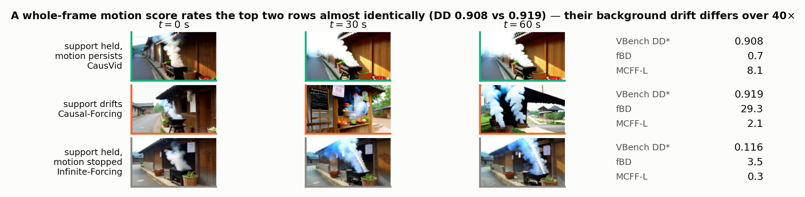

# SNF-Bench

<h2 align="center">SNF-Bench: Separating Static Drift from Natural Flow in Long-Horizon Fixed-Camera Video Generation</h2>

[](https://minar09.github.io/snfbench/)
[](https://arxiv.org/abs/2608.28694)
[](https://github.com/minar09/SNF-Bench)

<div align="center">
  <a href="https://stefan-baumann.eu/" target="_blank">Matiur Rahman Minar</a><sup>*,1</sup> ·
  <a href="https://owinhun.github.io/" target="_blank">Seunghun Oh</a><sup>1</sup> · 
  <a href="https://github.com/Jugahy" target="_blank">Ganghyeon Jeong</a><sup>1</sup> · 
  <a href="https://cviplab.sogang.ac.kr/cviplab/1249.html" target="_blank">Unsang Park</a><sup>1</sup>
</div>
<p align="center"> 
  <b><sup>1</sup>CVIP Lab @ Sogang University, Seoul, Korea</b><br/>Arxiv 2026
</p>



SNF-Bench, an evaluation framework for long-horizon fixed-camera generation that partitions each scene into static support and dynamic flow and reports static fidelity, flow persistence with absolute magnitude, and drift leakage separately.

## Introduction

This whitelisted package exposes the paper-facing metric definitions,
automatic partition, controlled synthetic translation check, and paired
bootstrap analysis without including the internal research repository.

## Scope

Paper results use RAFT optical flow and ORB features under `METRIC_SPEC v1.1`.
The small included fixture stores deterministic analytic adjacent-pair flow
fields, allowing reviewers to inspect and execute the metric post-processing
without downloading model weights. It is a smoke test, not a replacement for
the paper's RAFT measurements and not evidence for model rankings.

Prediction bundles are compressed NumPy files containing:

- `frames_rgb`: `uint8 [T,H,W,3]` decoded RGB frames;
- `flows`: `float32 [T-1,H,W,2]` adjacent-pair optical-flow fields;
- `sample_fps`: the effective sampled flow rate used by NBF.

## Setup

```bash
python -m venv .venv
. .venv/bin/activate
python -m pip install -r requirements.txt
```

## Required evaluation command

```bash
python generate_perturbations.py
python evaluate.py \
  --manifest benchmark_manifest.json \
  --pred_dir example_predictions
```

This writes `run_outputs/metric_record.json`.

## One-command smoke test

```bash
python smoke_test.py
python check_release.py
```

The smoke test reproduces one metric record, creates and evaluates a four-level
translation response curve, verifies that NBF increases monotonically, and
runs a paired 10,000-resample percentile bootstrap comparison.
The release gate then checks the explicit whitelist, text files for identity-
bearing or internal paths/names, and NumPy fixtures for object arrays.

## Inspect the partition

```bash
python make_partition.py \
  --prediction example_predictions/translation_0.00.npz \
  --out run_outputs/partition.npz
```

The command also writes a color preview to `run_outputs/partition.png`.

## Integrity notes

- The recorded T2V harness used one common conditional-only inference path with
  a four-step denoising schedule whose indices are warped by the released
  scheduler, six frames per block, and seed 0. Its YAML
  retained `guidance_scale: 5.0`, but that field was not consumed by the
  selected few-step pipeline; the release config records this explicitly.
- DAR is signed in storage and clipped only for the reported `DAR_report`.
- fBD may abstain (`null`) when too few repeatable static-region features exist.
- The evaluator does not turn incomplete inputs into successful records.
- No scalar composite leaderboard is produced.
- The package contains no internal checkpoints, participant data, or identity-bearing paths.

## Citation

If you use this codebase, please cite our paper:

```bibtex
@article{minar2026snfbench,
  title         = {SNF-Bench: Separating Static Drift from Natural Flow in Long-Horizon Fixed-Camera Video Generation},
  author        = {Matiur Rahman Minar and Seunghun Oh and Ganghyeon Jeong and Unsang Park},
  year          = {2026},
  eprint        = {2608.28694},
  archivePrefix = {arXiv},
  primaryClass  = {cs.CV},
  doi           = {10.48550/arXiv.2608.28694},
  url           = {https://arxiv.org/abs/2608.28694}
}
```
